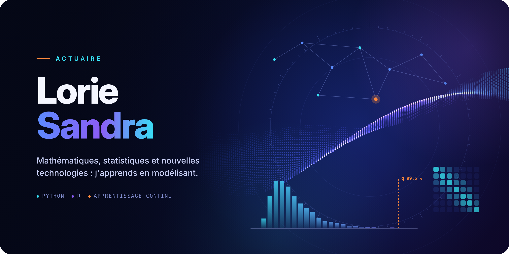
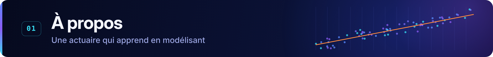
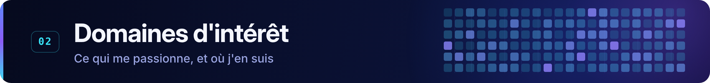
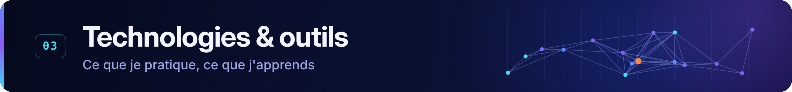
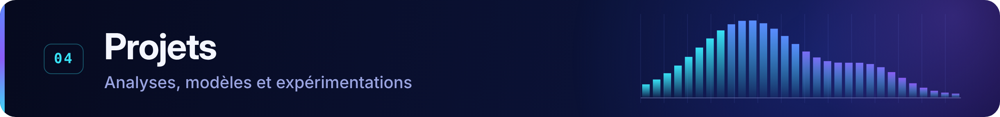
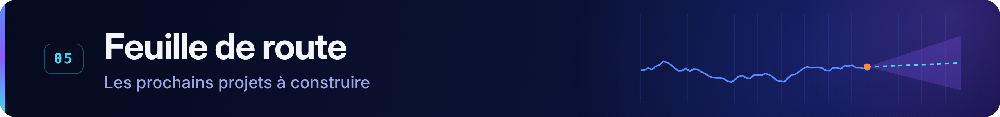
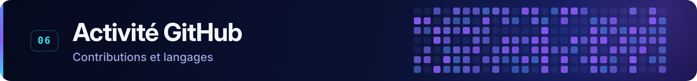

  

  
  
  

 

Je suis **Lorie Sandra**, diplômée d'un **Master en Actuariat** de l'Institut du Risque et de l'Assurance (Le Mans Université), où j'ai étudié les mathématiques appliquées, les probabilités et les statistiques au service de la mesure du risque.

**Mon parcours en actuariat**

- 🏦 **BPCE Vie** · *Alternance* : actuariat inventaire en assurance des emprunteurs et prévoyance individuelle
- 🌾 **Crédit Agricole Assurances** · *Stage* : inventaire et études techniques en santé et prévoyance collectives

**Ce qui m'intéresse techniquement :** les probabilités, la modélisation des risques, l'analyse de données, la programmation et l'automatisation des traitements.

> *« Je ne prétends pas tout savoir : je construis, je teste, je me trompe et je recommence. Chaque projet publié ici est une étape de cet apprentissage. »*

Mes notebooks sont perfectibles, et c'est tout l'intérêt de la démarche. Si tu repères une erreur ou une meilleure approche, **ouvre une *issue* sur le projet concerné** : chaque retour constructif est une occasion d'apprendre.

 

| Domaine | Ce qui m'anime | Où j'en suis |
|---|---|:-:|
| 📐 **Actuariat et modélisation des risques** | Provisionnement, inventaire, tarification : traduire un risque en chiffres justes |  |
| 🎲 **Statistiques et probabilités** | Lois, simulation, inférence : le socle de tout le reste |  |
| 💻 **Programmation avec Python et R** | Écrire du code clair et reproductible, et comparer les deux langages |  |
| 🧠 **Machine Learning et Deep Learning** | Comprendre ce que ces modèles apportent face aux GLM classiques |  |
| ✨ **LLM et intelligence artificielle** | Explorer leurs usages concrets en assurance, avec esprit critique |  |

 

<!-- ✏️ Ajuste ce tableau à ton niveau réel : déplace un outil de « En apprentissage » vers « Pratiqué » dès que tu l'as utilisé dans un projet publié. -->

| Catégorie | Pratiqué | En apprentissage |
|---|---|---|
| **Langages** |   | ✏️ *à compléter* |
| **Analyse et manipulation des données** |   |   |
| **Statistiques et modélisation** |     |   |
| **Machine Learning et IA** |  |     |
| **Visualisation et reporting** |  |    |

 

> 🔭 **Mon premier projet est en cours de construction.** Il apparaîtra ici dès sa publication, avec son notebook Python, son script R et une analyse commentée.

<!--
✏️ MODÈLE DE CARTE PROJET : copie ce bloc (sans les balises de commentaire) pour chaque projet terminé.

### 🚗 Titre explicite du projet

**En bref** · Une ou deux phrases pour présenter le projet.

**Problématique** · La question étudiée.

**Méthodes** · Les modèles et techniques utilisés.

**Technologies** ·  

📂 [Voir le repository](https://github.com/LorieSandra/nom-du-repo)

---
-->

 

Les projets que je prépare, dans l'ordre où je compte les réaliser. Clique sur un projet pour le détail.

<b>🩺 Prédire les frais médicaux d'assurés</b> · <i>à venir</i>

 

- **Problématique :** quels facteurs expliquent le coût de santé d'un assuré, et peut-on le prédire de façon fiable ?
- **Méthodes :** analyse exploratoire, régression linéaire, arbres de décision, random forest, validation croisée
- **Technologies :** Python (pandas, scikit-learn) · R (tidymodels)
- **Données :** *Medical Cost Personal Datasets* (Kaggle)
- **Repository :** à venir

<b>🚗 Tarification automobile : fréquence et sévérité</b> · <i>à venir</i>

 

- **Problématique :** comment construire une prime pure à partir de la fréquence et du coût des sinistres, et que change le machine learning par rapport au GLM ?
- **Méthodes :** GLM de Poisson avec exposition, GLM Gamma et Tweedie, gradient boosting, interprétation avec SHAP
- **Technologies :** Python (statsmodels, LightGBM) · R (glm, xgboost)
- **Données :** *freMTPL2*, portefeuille automobile français (Kaggle)
- **Repository :** à venir

<b>📈 Risque de marché et séries temporelles</b> · <i>à venir</i>

 

- **Problématique :** comment mesurer et anticiper le risque d'un portefeuille d'actions ?
- **Méthodes :** VaR et CVaR, modèles ARIMA et GARCH, frontière efficiente
- **Technologies :** Python (statsmodels, arch) · R (forecast, rugarch)
- **Données :** *S&P 500 stock data* (Kaggle)
- **Repository :** à venir

<b>🏦 Scoring du risque de crédit</b> · <i>à venir</i>

 

- **Problématique :** estimer la probabilité de défaut d'un emprunteur, un lien direct avec l'assurance des emprunteurs
- **Méthodes :** régression logistique, scorecard, gradient boosting, indice de Gini
- **Technologies :** Python (scikit-learn, LightGBM) · R (scorecard)
- **Données :** *Give Me Some Credit* (Kaggle)
- **Repository :** à venir

<b>🧠 Deep learning en tarification</b> · <i>à venir</i>

 

- **Problématique :** un réseau de neurones fait-il mieux qu'un GLM pour tarifer, et à quel prix pour l'interprétabilité ?
- **Méthodes :** réseaux de neurones, embeddings de variables catégorielles, approche combinée GLM et réseau (CANN)
- **Technologies :** Python (PyTorch) · R (torch)
- **Données :** *freMTPL2* (Kaggle)
- **Repository :** à venir

<b>💬 IA et assurance : la voix des assurés</b> · <i>à venir</i>

 

- **Problématique :** que disent les avis clients sur les assureurs, et un LLM peut-il les analyser aussi bien qu'un modèle entraîné ?
- **Méthodes :** TF-IDF, CamemBERT, classification par LLM
- **Technologies :** Python (scikit-learn, Hugging Face) · R (tidytext)
- **Données :** *Insurance Reviews France* (Kaggle)
- **Repository :** à venir

<b>🤖 Assistant actuariel avec RAG</b> · <i>à venir</i>

 

- **Problématique :** un LLM peut-il répondre à des questions actuarielles en s'appuyant sur une documentation publique ?
- **Méthodes :** embeddings, recherche documentaire, génération augmentée (RAG)
- **Technologies :** Python (sentence-transformers, FAISS)
- **Données :** documents publics (rapports SFCR, conditions générales)
- **Repository :** à venir

 

  
  

  

<!-- Graphique de contributions : généré chaque jour par l'action .github/workflows/contributions.yml, hébergé dans ce dépôt (branche « output »), donc indépendant de tout service externe. -->
<picture>
  <source media="(prefers-color-scheme: dark)" srcset="https://raw.githubusercontent.com/LorieSandra/LorieSandra/output/contributions-dark.svg" />
  <source media="(prefers-color-scheme: light)" srcset="https://raw.githubusercontent.com/LorieSandra/LorieSandra/output/contributions-light.svg" />
  
</picture>

 

Une remarque sur un notebook, une piste d'amélioration, une idée de projet ? Les échanges sont les bienvenus.

  
  
  <!-- ✏️ LinkedIn : retire les balises de commentaire et ajoute ton lien quand ton profil sera créé.
  
  -->
  <!-- ✏️ E-mail : retire les balises de commentaire si tu veux afficher une adresse de contact.
  
  -->

 

Actuaire de formation · Python & R · un modèle après l'autre

